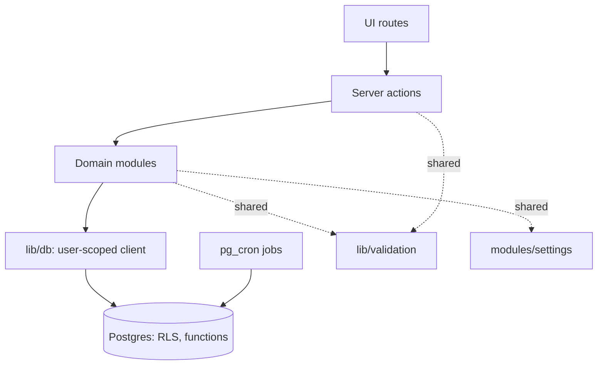
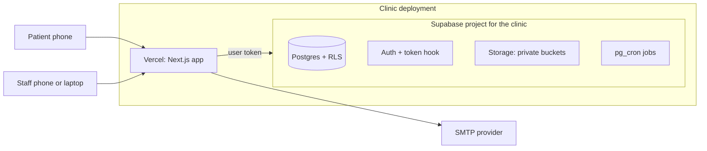
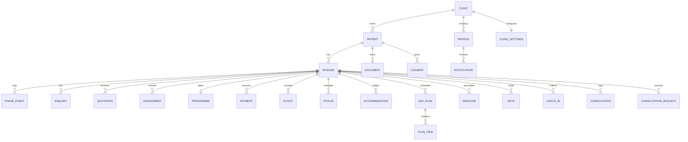

# Architecture Spine — AyurSaathi

## Design Paradigm

**Database-enforced modular monolith.** One deployable Next.js application. Access rules live in the database (row-level security); business rules live in server-side domain modules; the browser holds neither.

| Layer | Location | Role |
| --- | --- | --- |
| UI | `app/(public)`, `app/(patient)`, `app/(clinic)` | Renders; calls server actions; holds no rules |
| Actions | `modules/<phase>/actions.ts` | Validates input, calls the database as the signed-in user, returns a typed Result |
| Domain | `modules/<phase>/` | One module per journey phase plus shared modules |
| Data | `lib/db`, `supabase/migrations` | Typed queries as the user; policies and functions in SQL |



## Invariants & Rules

### AD-1 — Database is the authority on access `[ADOPTED]`

- **Binds:** all
- **Prevents:** access checks that exist only in UI or server code, so a missed check leaks health data
- **Rule:** every clinic-owned table has row-level security enabled and at least one policy; the UI hides, the database decides. No table is created without its policies in the same migration.

### AD-2 — Deployment per clinic, clinic key on every row `[ADOPTED]`

- **Binds:** all
- **Prevents:** shared state across clinics at the infrastructure level; policies that forget the clinic
- **Rule:** one Supabase project and one Vercel deployment per clinic, same codebase, selected by environment variables. Every clinic-owned table also carries `clinic_id`, and every policy checks it before role. No per-request project routing and no keys for several clinics in one runtime.

### AD-3 — Identity comes from the token, verified with getClaims `[ADOPTED]`

- **Binds:** FR-1, FR-2, FR-3, FR-4, FR-5
- **Prevents:** policies that each look up roles differently; trusting an unverified session on the server
- **Rule:** a Supabase auth hook places `role` and `clinic_id` in the user's token. SQL helper functions (`app.current_role()`, `app.current_clinic()`, `app.current_patient()`) are the only way policies read them. Server code verifies identity with `getClaims`, never `getSession`. A role change applies at the next token refresh, and the user is signed out on a role change. `proxy.ts` refreshes the session.

### AD-4 — The browser never holds privileged keys

- **Binds:** all
- **Prevents:** a key that bypasses row-level security reaching the browser
- **Rule:** the browser and all request handling use the publishable key with the user's token. The service-role key exists only in server-only scheduled jobs and admin scripts, never in a `NEXT_PUBLIC_` variable.

### AD-5 — Writes go through server actions with one result shape

- **Binds:** FR-1..FR-48
- **Prevents:** divergent validation and error handling per feature; duplicate effects on retry
- **Rule:** every mutation is a server action in its module. Input is validated by a shared Zod schema in `lib/validation`. Every action returns `{ ok: true, data }` or `{ ok: false, code, message, fieldErrors }` with `code` one of `validation_failed`, `not_found`, `forbidden`, `conflict`, `rate_limited`, `upload_rejected`, `unavailable`. Retried actions (publish a Day Plan, submit a Check-in, send an Invite) take an idempotency key and are safe to run twice.

### AD-6 — Modules are bounded by journey phase

- **Binds:** FR-8..FR-48
- **Prevents:** feature code reaching across phases into each other's tables
- **Rule:** modules are `access`, `patients` (record, episodes, phases), `onboarding`, `documents`, `enquiry`, `assessment`, `planning`, `arrival`, `care`, `continuity`, `notifications`, `settings`. A module reads and writes only its own tables. Cross-module use goes through the other module's exported functions, and only `patients` is imported by all.

### AD-7 — Clinic-specific content is data, never code `[ADOPTED]`

- **Binds:** FR-8, FR-36, FR-38, FR-16
- **Prevents:** Ayurvedgram specifics hard-coded; flag logic buried in code
- **Rule:** branding, terminology labels, Check-in questions, Flag Rules, consent text versions and templates live in a clinic settings store, versioned and validated by a Zod schema, read only through `modules/settings`. UI text lives in `messages/en.json` with terminology keys that settings can override. Flag evaluation is a pure function of configured rules and answers; it contains no clinical thresholds.

### AD-8 — Visibility is a column with fixed values

- **Binds:** FR-5, FR-18, FR-22, FR-31
- **Prevents:** per-feature ways of hiding notes and documents from Patients
- **Rule:** Notes, Assessments and Documents carry `visibility` of `shared` or `staff_only`. Patient policies allow only `shared`. Patients read patient-safe views, not base tables, where columns differ.

### AD-9 — Time is UTC; the Patient's zone is data

- **Binds:** FR-25, FR-41, FR-47
- **Prevents:** time zone errors in flights and check-in prompts
- **Rule:** all instants are stored as `timestamptz` in UTC. The Patient's IANA time zone is stored on the Patient. Scheduled prompts are computed from local date and time plus zone, then stored as UTC. Display converts at the edge.

### AD-10 — Notifications are an outbox; the database schedules

- **Binds:** FR-41, FR-45, FR-46
- **Prevents:** duplicate sends; channel logic scattered through features
- **Rule:** events write a row to `notifications` (pending, scheduled_for). `pg_cron` runs hourly and calls idempotent database functions that create due Check-ins and notifications, protected by unique keys on episode, template and date. A sender delivers by channel (in-app, email) and records success or failure with up to three attempts. No WhatsApp or web push.

### AD-11 — Files are private, clinic-pathed and signed

- **Binds:** FR-17, FR-18
- **Prevents:** public or guessable file access
- **Rule:** private buckets only. Path is `<clinic_id>/<patient_id>/<episode_id or general>/<document_id>.<ext>`. Storage policies mirror table policies. Uploads and downloads use short-lived signed URLs. HEIC is converted to JPEG in the browser before upload; only PDF, JPG and PNG up to 15 MB reach storage.

### AD-12 — Isolation is proven by tests that cannot be skipped

- **Binds:** FR-4, FR-5, FR-6
- **Prevents:** a table or bucket shipped without an isolation test
- **Rule:** pgTAP tests (via `supabase test db`) run each table and bucket as Patient A, Patient B, Staff of Clinic X and Staff of Clinic Y, with two Clinic rows seeded in one database, and as a Patient against Staff-only rows. A check lists every clinic-owned table and bucket and fails the build if any has no test. A few Playwright tests repeat the key cases through the app.

### AD-13 — Schema changes are versioned and rolled out to every clinic

- **Binds:** all
- **Prevents:** clinic projects drifting out of step
- **Rule:** all schema changes are SQL migration files (Supabase CLI), forward-fix only. A manifest lists each clinic project reference (no secrets). The release routine applies migrations to every project in the manifest before deploying the app. Seed data is invented data only and idempotent.

### AD-14 — No personal health data in logs, errors or analytics

- **Binds:** all
- **Prevents:** health data leaking through operational tooling
- **Rule:** log identifiers and event names only. Error reports carry a reference ID, never request bodies. No analytics in the prototype.

### AD-15 — All writes pass one place so audit can be added `[ADOPTED]`

- **Binds:** all
- **Prevents:** the deferred audit log needing a rewrite
- **Rule:** because writes go through server actions (AD-5) and rows carry `created_by` and `updated_at`, an audit trail can be added in one place later. The prototype does not ship the audit log or staff MFA; both are a hard gate before real patient data.

## Consistency Conventions

| Concern | Convention |
| --- | --- |
| Naming | Tables plural snake_case; columns snake_case; TypeScript camelCase; files kebab-case; module folders named for the journey phase; Glossary terms used exactly in UI labels and identifiers (`check_in`, `day_plan`, `staff_only`) |
| Data & formats | Ids are uuid; instants `timestamptz` UTC; money as integer minor units plus ISO currency; enumerations as text with check constraints; soft delete with `deleted_at` where retention may apply |
| Errors | Typed Result (AD-5); plain, specific user messages; form input is kept on error and the first invalid field takes focus |
| Auth & state | Read in server components as the user; mutate in server actions; no client-side trust; no global mutable state |
| Config | Environment variables per deployment; no secrets in the repository; settings data in the database |
| Language | English strings in `messages/en.json`; no inline UI strings |
| Responsive | Every Staff screen works on phone and laptop; status shown in text as well as colour |
| Tests | Each new table ships with its policies and its isolation test in the same change |

## Stack

| Name | Version |
| --- | --- |
| Node.js | 22 LTS (Next requires 20.9 or newer) |
| Next.js (App Router) | 16.4.3 |
| React | 19.3.1 |
| TypeScript | 7.0.2 `[ASSUMPTION: toolchain compatibility; fall back to 5.x]` |
| @supabase/supabase-js | 2.118.0 |
| @supabase/ssr | 0.12.7 |
| Supabase CLI | 2.122.0 |
| Zod | 4.6.7 |
| Tailwind CSS | 4.3.3 `[ASSUMPTION: starter pins 3.4; fall back if the scaffold does not build]` |
| Vitest | 5.0.5 |
| Playwright | 1.64.1 |
| Serwist (PWA service worker) | 9.5.13 |
| Database | Supabase-managed Postgres with pgTAP and pg_cron |
| Hosting | Vercel and Supabase, India region (Mumbai preferred) `[verify at account creation]` |
| Mail (dev) | Mailpit locally; sandbox SMTP for the hosted prototype |

## Structural Seed





```text
app/
  (public)/        sign-in, invite, install help
  (patient)/       home, plan, documents, check-in
  (clinic)/        patients, onboarding, record tabs, review queue, settings
modules/
  access/ patients/ onboarding/ documents/ enquiry/ assessment/
  planning/ arrival/ care/ continuity/ notifications/ settings/
lib/               db/  validation/  time/  i18n/
messages/en.json
proxy.ts           session refresh
supabase/
  migrations/      versioned SQL (tables, policies, functions, cron)
  tests/           pgTAP isolation tests per table and bucket
  seed.sql         invented data only
clinics.json       manifest of clinic project references (no secrets)
tests/e2e/         Playwright
```

## Capability → Architecture Map

| PRD feature | Module | Main tables |
| --- | --- | --- |
| 4.1 Access, roles, isolation, settings | `access`, `settings` | profiles, clinics, clinic_settings |
| 4.2 Record, episodes, phases | `patients` | patients, episodes, phase_events |
| 4.3 Onboarding, documents | `onboarding`, `documents` | patients, consents, documents |
| 4.4 Enquiry, assessment, planning | `enquiry`, `assessment`, `planning` | enquiries, quotations, assessments, programmes, payments |
| 4.5 Arrival | `arrival` | flights, pickups, accommodations |
| 4.6 Care | `care` | day_plans, plan_items, medicines, notes, check_ins |
| 4.7 Continuity | `continuity` | check_ins, consultations, consultation_requests |
| 4.8 Notifications | `notifications` | notifications |
| 4.9 Foundations (time zone, seed) | `patients`, `lib/time` | patients, seed.sql |

## Deferred

- Audit log and staff MFA: hard gate before real patient data (AD-15).
- Malware scanning of uploads, field-level encryption of passport numbers, retention and erasure jobs: wait for legal advice.
- WhatsApp sending, web push, email provider and sending domain: later by owner decision.
- Error tracking and monitoring tools; availability and backup targets.
- Automated provisioning of a second clinic's project and deployment.
- Offline use beyond the app shell.

## Open Questions

1. Does the trimmed official starter build and run on Next.js 16.4 and `@supabase/ssr` 0.12 (proxy.ts, getClaims)? Verify at scaffold.
2. Is Mumbai offered for new database projects on the owner's plan, and what is the latency to Europe?
3. Do TypeScript 7 and Tailwind 4 work with the rest of the toolchain, or do we pin TypeScript 5 and Tailwind 3.4?
4. Does in-browser HEIC conversion work acceptably on the oldest phones the clinic's patients use? Real-device test.
5. Which sandbox SMTP serves the hosted demo, since Supabase's built-in sender is limited?
