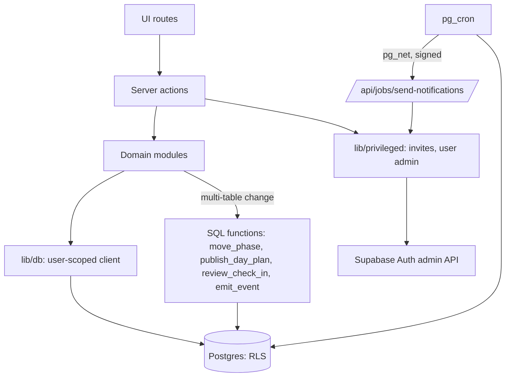
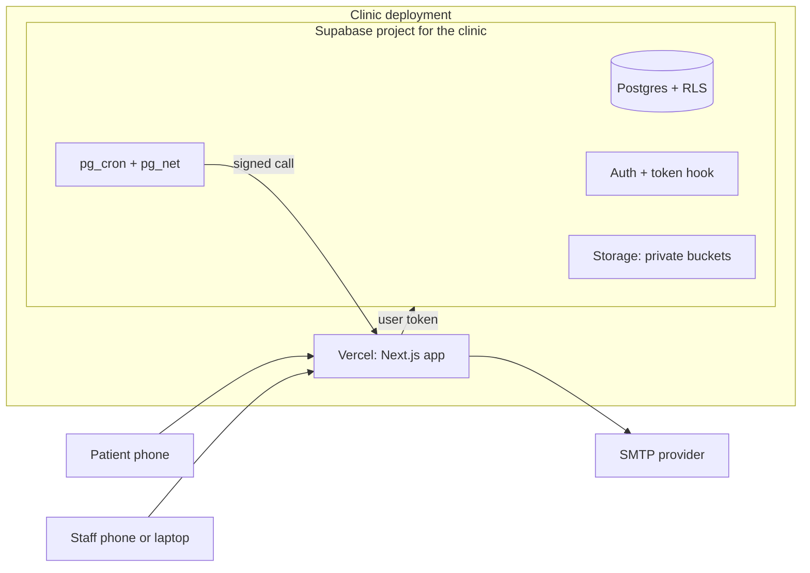
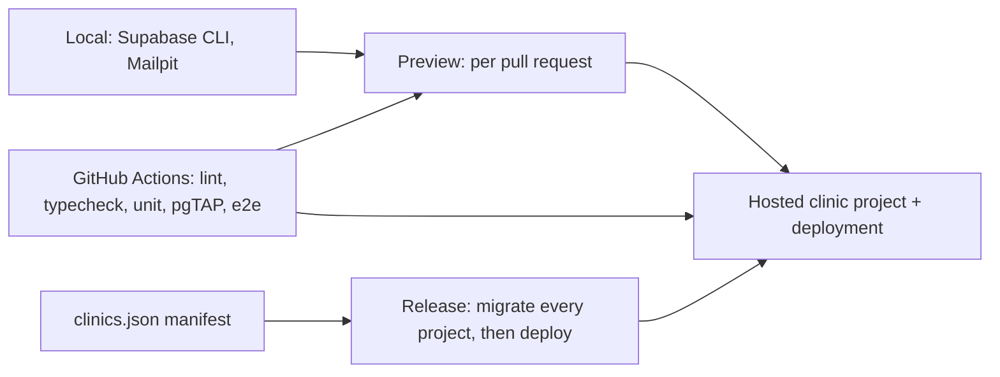
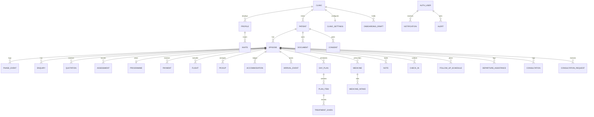

# Architecture Spine — AyurSaathi

## Design Paradigm

**Database-enforced modular monolith.** One deployable Next.js application per clinic. Access rules live in the database (row-level security). Business rules live in server-side domain modules. Any change that touches more than one module's tables is a single SQL function run in one transaction. The browser holds none of these.

| Layer | Location | Role |
| --- | --- | --- |
| UI | `app/(public)`, `app/(patient)`, `app/(clinic)` | Renders; calls server actions; holds no rules |
| Actions | `modules/<name>/actions.ts` | Validates input, calls the database as the signed-in user, returns a typed Result |
| Domain | `modules/<name>/` | One module per journey phase plus shared modules; owns its tables |
| Data | `lib/db`, `supabase/migrations` | Typed queries as the user; policies, functions and jobs in SQL |
| Privileged | `lib/privileged` | The single sanctioned place that uses the service key (AD-4) |



## Invariants & Rules

### AD-1 — Database is the authority on access `[ADOPTED]`

- **Binds:** all
- **Prevents:** access checks that exist only in UI or server code; permissive policies that pass a "has a policy" check
- **Rule:** every table in an exposed schema has row-level security enabled and policies that name clinic and role; no policy may use an unconditional `true`. A CI check scans migrations for tables without policies and for unconditional policies. No table is created without its policies in the same migration.

### AD-2 — Deployment per clinic, clinic key on every row `[ADOPTED]`

- **Binds:** all
- **Prevents:** shared state across clinics at the infrastructure level; policies that forget the clinic
- **Rule:** one Supabase project and one Vercel deployment per clinic, same codebase, selected by environment variables. Every clinic-owned table carries `clinic_id` (the `clinics.id`), and every policy checks it before role. No per-request project routing. Two Clinic rows exist only in local and test databases for the isolation suite; a hosted clinic project holds exactly one.

### AD-3 — Identity comes from the token; claims are never in `role`

- **Binds:** FR-1, FR-2, FR-3, FR-4, FR-5
- **Prevents:** policies that read roles differently; breaking the database role switch; stale elevated access
- **Rule:**
  - An auth hook adds `app_role` and `clinic_id` to the token from `app_metadata`. It never overwrites the top-level `role` claim, which selects the database role.
  - `app_role` is exactly one of `patient`, `coordinator`, `doctor`, `admin`. Policies read claims only through `app.user_role()`, `app.user_clinic()`, `app.user_patient_id()` and `app.is_staff()`; nothing else says "staff".
  - Server code verifies identity with `getClaims`, never `getSession`.
  - Access tokens expire in 10 minutes or less, and `app.user_role()` also requires an active profile, so a demoted or disabled user loses access at once. A pgTAP case proves this with an old token.
  - `proxy.ts` refreshes the session.

### AD-4 — One sanctioned privileged path

- **Binds:** FR-2, FR-19, FR-46, FR-8
- **Prevents:** the service key leaking into request code, or each module inventing its own use of it
- **Rule:** the service-role key is read only in `lib/privileged`, server-only, and only for (a) creating and inviting auth users, (b) user administration by Admin, (c) sending notifications from the sender route. It is set only in the Production scope of the deployment, never in a `NEXT_PUBLIC_` variable, never in the browser. Each privileged function takes `clinic_id` from the caller's verified token, never from input, and checks the caller's role first. The sender route accepts only signed calls from the database scheduler.

### AD-5 — Writes go through server actions with one result shape

- **Binds:** FR-1..FR-48
- **Prevents:** divergent validation and error handling; duplicate effects on retry
- **Rule:** every mutation is a server action in its module. Input is validated by a shared Zod schema in `lib/validation`. Every action returns `{ ok: true, data }` or `{ ok: false, code, message, fieldErrors }` with `code` one of `validation_failed`, `not_found`, `forbidden`, `conflict`, `rate_limited`, `upload_rejected`, `unavailable`. Retried actions (publish a Day Plan, submit a Check-in, send an Invite) take an idempotency key stored in the shared `idempotency_keys` table (key, action, clinic, result reference, created_at) through one helper; no module keeps its own.

### AD-6 — Every table has one owner module

- **Binds:** FR-8..FR-48
- **Prevents:** two modules writing one table; feature code reaching across phases
- **Rule:** each table below has exactly one owner module, the only code that writes it. Other modules call the owner's exported functions or the named SQL functions. An import-boundary lint rule fails the build on a module importing another's internals.

| Owner module | Tables |
| --- | --- |
| `access` | profiles, invites |
| `settings` | clinics, clinic_settings |
| `patients` | patients, episodes, phase_events, consents |
| `onboarding` | onboarding_drafts |
| `documents` | documents |
| `enquiry` | enquiries, quotations |
| `assessment` | assessments |
| `planning` | programmes, payments |
| `arrival` | flights, pickups, accommodations, arrival_events |
| `care` | day_plans, plan_items, treatments_given, medicines, medicine_intakes, notes, check_ins |
| `continuity` | follow_up_schedules, departure_assistance, consultations, consultation_requests |
| `notifications` | notifications, alerts |
| shared SQL | idempotency_keys |

### AD-7 — Clinic-specific content is data, never code `[ADOPTED]`

- **Binds:** FR-8, FR-36, FR-38, FR-16
- **Prevents:** Ayurvedgram specifics hard-coded; flag logic buried in code
- **Rule:** branding, terminology labels, Check-in questions, Flag Rules, consent text versions and templates live in `clinic_settings`, versioned and validated by a Zod schema, read only through `modules/settings`. Write policies are split by section: Admin writes branding and terminology; Doctor writes Check-in questions and Flag Rules. UI text lives in `messages/en.json` with terminology keys that settings can override. Flag evaluation is one SQL function, a pure function of configured rules and answers, with no clinical thresholds in code.

### AD-8 — Patient visibility is explicit on every table a Patient can read

- **Binds:** FR-5, FR-18, FR-22, FR-28, FR-31, FR-32, FR-33
- **Prevents:** per-feature ways of hiding rows; views that skip row-level security
- **Rule:**
  - Notes, Assessments and Documents carry `visibility` of `shared` or `staff_only`, and Patients read only `shared`.
  - Day Plans are visible to Patients only when `status = 'published'`. Medicines, Pickup, Accommodation, flights and Check-ins are visible to the Patient of that Episode only.
  - Staff capabilities follow one checked-in matrix, `supabase/capability-matrix.json`, which both policies and the pgTAP tests read. Where the matrix says Coordinator reads Shared Notes only, that is what the test asserts.
  - Every view is created `security_invoker = true`, lives outside exposed schemas unless needed, has `anon` grants revoked, and is covered by the isolation tests.
  - Rows with `deleted_at` set are excluded by every Patient policy.

### AD-9 — Time is UTC; the Patient's zone is data

- **Binds:** FR-25, FR-36, FR-41, FR-47
- **Prevents:** time zone errors in flights and Check-in prompts; ambiguous "today"
- **Rule:** all instants are `timestamptz` in UTC. The Patient's IANA time zone is stored on the Patient. A Check-in's `local_date` is the date in the Patient's zone at `scheduled_for`. Display converts at the edge.

### AD-10 — Notifications are an outbox written by one function

- **Binds:** FR-9, FR-29, FR-30, FR-41, FR-44, FR-45, FR-46
- **Prevents:** many modules inventing notification shapes; duplicate sends; Patients without a valid recipient
- **Rule:**
  - All notification and alert writes go through `app.emit_event(type, recipient_user_id, subject, dedupe_key, payload)` with a closed event enum. The recipient is always an auth user id, for Patients and Staff alike; role-wide events fan out to one row per user.
  - Alerts (FR-9) are rows in `alerts` with resolve semantics, owned by `notifications`. "I have landed" and "I need help" are `arrival_events` rows owned by `arrival`, which emit an event.
  - `pg_cron` runs hourly, creates due Check-ins and notifications through idempotent functions, and calls the sender route through `pg_net` with a signed header. The sender delivers by channel (in-app, email) and retries up to three attempts, recording status.
  - Email bodies carry no health content, only a prompt to open the app.

### AD-11 — Check-ins have one owner, one table, one key `[ADOPTED]`

- **Binds:** FR-36, FR-37, FR-38, FR-39, FR-41, FR-42
- **Prevents:** Care and Continuity building two Check-in tables or clashing keys
- **Rule:** `check_ins` is owned by `care`, with `kind` (`daily` or `follow_up`), `template_id`, `local_date`, `answers jsonb`, `flags`, `reviewed_by`, `reviewed_at`. The unique key is `(episode_id, kind, template_id, local_date)`. `continuity` owns only `follow_up_schedules` and creates due follow-up Check-ins by calling `care`'s `create_due_check_in`. Flags are written only by the flag-evaluation function (AD-7). Both Check-in kinds enter the one Review Queue.

### AD-12 — Multi-table changes are single SQL functions

- **Binds:** FR-10, FR-11, FR-33, FR-39, FR-23
- **Prevents:** half-applied changes; the Episode phase updated without its history
- **Rule:** any change spanning more than one module's tables is one SQL function in one transaction: `move_phase`, `publish_day_plan`, `review_check_in`, `emit_event`. `episodes.phase` is writable only through `move_phase`, which writes `phase_events` in the same transaction. Staff may move an Episode to any Phase, forward or back, and every move is recorded; a new Episode for a returning Patient starts at Assessment or Planning. `planning` and other modules request a phase move by calling `move_phase`, never by updating `episodes`.

### AD-13 — Files are private, joined to their record and short-lived

- **Binds:** FR-17, FR-18
- **Prevents:** public or guessable file access; browser-only limits; lingering links
- **Rule:**
  - Documents attach only to a saved patient; onboarding drafts hold no files, so there is nothing to clean up when a draft is abandoned.
  - Private buckets only. Path is `<clinic_id>/<patient_id>/<episode_id or general>/<document_id>.<ext>`. Storage policies join to `documents` to enforce clinic, Patient and `visibility`; a path prefix alone is not enough.
  - Buckets set size and allowed MIME types, upsert is disallowed, and the server re-checks file content type. Files are served with `nosniff` and attachment disposition.
  - Download links are generated per click and expire in about 60 seconds. Uploads use short-lived signed URLs.
  - HEIC is converted to JPEG in the browser before upload; only PDF, JPG and PNG up to 15 MB reach storage.

### AD-14 — Invites and one-time links cannot grant access by themselves

- **Binds:** FR-2, FR-19
- **Prevents:** privilege escalation through an invite; links consumed by mail scanners; account enumeration
- **Rule:** public sign-up is disabled, and the token hook gives no role by default. An invite is a row in `invites` with a hashed token, bound to an email, a clinic, a role and a Patient; role, clinic and Patient come only from that row, never from the URL or user metadata. The link opens a page where the user presses a button to redeem it (a POST), or the user types the code, so a mail scanner's GET does not consume it. Invites and codes expire quickly, requests return the same response for known and unknown emails, and resend has a cooldown and rate limit. Redirect URLs are an explicit allowlist. Claims are read from `app_metadata` only.

### AD-15 — Definer functions are exceptions with rules

- **Binds:** AD-3, AD-10, AD-12
- **Prevents:** functions that skip row-level security or are callable by anyone
- **Rule:** claim helpers run as invoker and only read claims. Any `SECURITY DEFINER` function states its reason in a comment, sets `search_path` to empty, lives in a private schema, and has `EXECUTE` revoked from public, `anon` and `authenticated` unless it is deliberately callable. Scheduled functions take no client parameters. Functions and views are included in the isolation tests.

### AD-16 — Isolation is proven by tests that cannot be skipped

- **Binds:** FR-4, FR-5, FR-6
- **Prevents:** a table, view, function or bucket shipped without an isolation test
- **Rule:** pgTAP tests (via `supabase test db`) run each table, view, exposed function and bucket as Patient A, Patient B, Staff of Clinic X, Staff of Clinic Y (two Clinic rows in one test database), a demoted user with an old token, and a Patient against `staff_only` rows. A check lists every such object and fails the build if one has no test. A few Playwright tests repeat the key cases through the app.

### AD-17 — Schema changes are versioned and rolled out to every clinic

- **Binds:** all
- **Prevents:** clinic projects drifting out of step
- **Rule:** all schema changes are SQL migration files (Supabase CLI), forward-fix only. `clinics.json` lists each clinic project reference (no secrets). The release routine is: CI passes; apply migrations to every project in the manifest; then deploy that clinic's app. Seed data is invented and idempotent.

### AD-18 — No personal health data in logs, errors, analytics or caches

- **Binds:** all
- **Prevents:** health data leaking through operational tooling or the device
- **Rule:** log identifiers and event names only to standard output. Errors carry a reference ID, never request bodies. No analytics in the prototype. The service worker uses network-only for authenticated routes, caches only the app shell, and clears its caches on sign-out.

### AD-19 — Browser hardening and rate limits are part of the shell

- **Binds:** FR-2, FR-17, FR-19
- **Prevents:** header-less deployments and unbounded abuse of sign-in, invite and upload
- **Rule:** the app sets a strict content security policy, frame, referrer and permissions headers. Sign-in, invite, resend and upload endpoints are rate limited, and the limit produces the `rate_limited` result.

### AD-20 — Audit trail can be added in one place `[ADOPTED]`

- **Binds:** all
- **Prevents:** the deferred audit log needing a rewrite
- **Rule:** because writes go through server actions (AD-5) and SQL functions (AD-12) and rows carry `created_by` and `updated_at`, an audit trail can be added centrally later. The prototype does not ship the audit log or staff MFA; both are a hard gate before real patient data.

## Consistency Conventions

| Concern | Convention |
| --- | --- |
| Naming | Tables plural snake_case; columns snake_case; TypeScript camelCase; files kebab-case; module folders named for the owner (AD-6); Glossary terms used exactly (`check_in`, `day_plan`, `staff_only`) |
| Data & formats | Ids are uuid; instants `timestamptz` UTC; money as integer minor units plus ISO currency with its ISO 4217 exponent applied in `lib/money`; enumerations as text with check constraints; soft delete with `deleted_at` |
| Errors | Typed Result (AD-5); plain, specific user messages; form input is kept on error and the first invalid field takes focus |
| Auth & state | Read in server components as the user; mutate in server actions or SQL functions; no client-side trust; no global mutable state |
| Config | Environment variables per deployment; no secrets in the repository; clinic content in the database |
| Language | English strings in `messages/en.json`; no inline UI strings |
| Responsive | Every Staff screen works on phone and laptop; status shown in text as well as colour |
| Tests | Each new table, view, function and bucket ships with its policies and its isolation test in the same change |

## Stack

| Name | Version |
| --- | --- |
| Node.js | 24 LTS (Vitest 5 needs 22.12 or newer; Node 26 is also LTS) |
| Next.js (App Router) | 16.4.3 |
| React | 19.3.1 |
| TypeScript | 5.x pinned (the starter's line); 7.0.2 is a later, separate upgrade |
| @supabase/supabase-js | 2.118.0 |
| @supabase/ssr | 0.12.7 |
| Supabase CLI | 2.122.0 |
| Zod | 4.6.7 |
| Tailwind CSS | 4.3.3 `[ASSUMPTION: starter pins 3.4; migrate at scaffold or fall back]` |
| Vitest | 5.0.5 |
| Playwright | 1.64.1 |
| PWA service worker | Serwist 9.5.13: `@serwist/turbopack` or `@serwist/next` with `next build --webpack` `[ASSUMPTION: verify at scaffold]` |
| Database | Supabase-managed Postgres with the pgTAP, pg_cron and pg_net extensions enabled |
| Hosting | Vercel and Supabase, India region (Mumbai preferred) `[verify at account creation]` |
| Mail (dev) | Mailpit locally; sandbox SMTP for the hosted prototype |

**Starter delta (official `with-supabase` example, trimmed):** pin `next` and the Supabase packages instead of `latest`; migrate Tailwind 3.4 to 4 and remove `tailwind.config.ts` if used; bump `eslint-config-next` to match Next 16; replace `lib/supabase` with `lib/db`; keep `proxy.ts` and `getClaims`; remove sample auth pages that allow public sign-up.

## Structural Seed







Every clinic-owned table in the diagram also carries `clinic_id`; it is omitted from the relationships for legibility.

```text
app/
  (public)/        sign-in, invite redemption, install help
  (patient)/       home, plan, documents, check-in
  (clinic)/        patients, onboarding, record tabs, review queue, settings
  api/jobs/        signed endpoints called by the database scheduler
modules/
  access/ settings/ patients/ onboarding/ documents/ enquiry/ assessment/
  planning/ arrival/ care/ continuity/ notifications/
lib/               db/  privileged/  validation/  time/  money/  i18n/
messages/en.json
proxy.ts           session refresh
supabase/
  migrations/      versioned SQL (tables, policies, functions, cron)
  tests/           pgTAP isolation tests per table, view, function, bucket
  capability-matrix.json
  seed.sql         invented data only
clinics.json       manifest of clinic project references (no secrets)
tests/e2e/         Playwright
```

## Environments & Operations

- **Environments:** local (Supabase CLI plus Mailpit), pull-request preview, and the hosted clinic project with its deployment. Each clinic has its own environment variables; secrets live in the host's secret store, never in the repository.
- **CI/CD:** GitHub Actions run lint, typecheck, unit tests, migration check, policy and test-coverage checks (AD-1, AD-16), pgTAP and Playwright. Releases follow AD-17.
- **Prototype operations:** a health check route; logs to standard output (AD-18). Backups use the platform's default for the prototype.
- **Gate before real data (all required):** audit log including read access, staff MFA enforced in policies, lawyer-approved consent and retention, data processing terms with each vendor, region and hosting confirmed, backup and restore tested, key-rotation runbook, a security review.

## Capability → Architecture Map

| PRD feature | Owner module | Main tables |
| --- | --- | --- |
| 4.1 Access, roles, isolation, settings | `access`, `settings` | profiles, invites, clinics, clinic_settings |
| 4.2 Record, episodes, phases | `patients` | patients, episodes, phase_events |
| 4.3 Onboarding, documents | `onboarding`, `documents`, `patients` | onboarding_drafts, documents, consents |
| 4.4 Enquiry, assessment, planning | `enquiry`, `assessment`, `planning` | enquiries, quotations, assessments, programmes, payments |
| 4.5 Arrival | `arrival` | flights, pickups, accommodations, arrival_events |
| 4.6 Care | `care` | day_plans, plan_items, treatments_given, medicines, medicine_intakes, notes, check_ins |
| 4.7 Continuity | `continuity` | follow_up_schedules, departure_assistance, consultations, consultation_requests |
| 4.8 Notifications | `notifications` | notifications, alerts |
| 4.9 Foundations (time zone, seed) | `patients` | patients, seed.sql |

## Deferred

- Audit log and staff MFA: hard gate before real patient data (AD-20).
- Malware scanning, field-level encryption of passport numbers, retention and erasure jobs: wait for legal advice.
- WhatsApp sending, web push, email provider and sending domain: later by owner decision.
- Error tracking tool, availability targets, backup targets: set in the gate before real data.
- Automated provisioning of a second clinic's project and deployment.
- Offline use beyond the app shell.

## Open Questions

1. Does the trimmed official starter build and run on Next.js 16.4 and `@supabase/ssr` 0.12 (proxy.ts, getClaims)? Verify at scaffold.
2. Is Mumbai offered for new database projects on the owner's plan, and what is the latency to Europe?
3. Which Serwist package and build mode works with Next 16, and does Tailwind 4 build with the starter?
4. Does in-browser HEIC conversion work acceptably on the oldest phones the clinic's patients use? Real-device test.
5. Which sandbox SMTP serves the hosted demo, since Supabase's built-in sender is limited?
6. Is the sender route (called by the scheduler) the right runtime, or should a Supabase Edge Function send mail? `[ASSUMPTION: the Next.js route, to keep one codebase.]`
