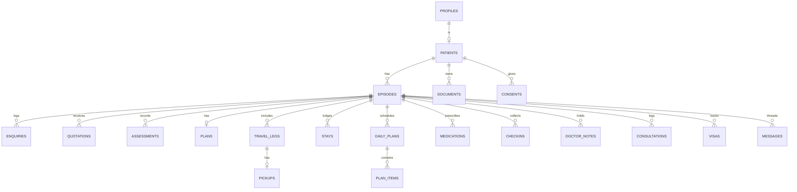
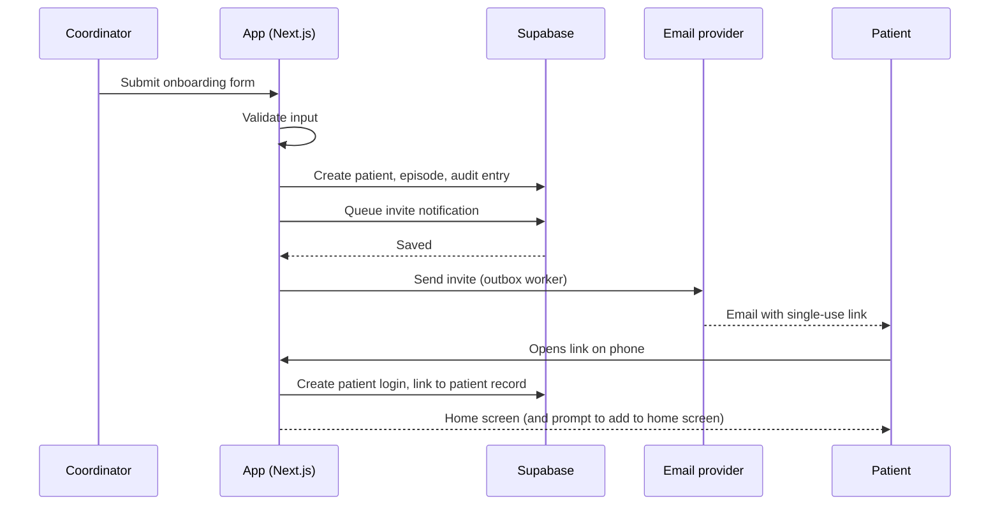
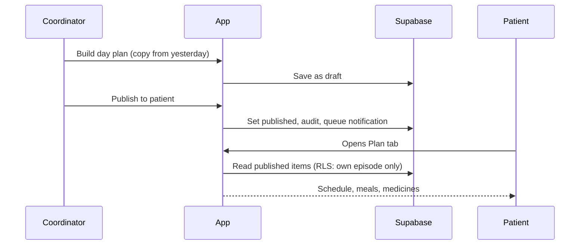
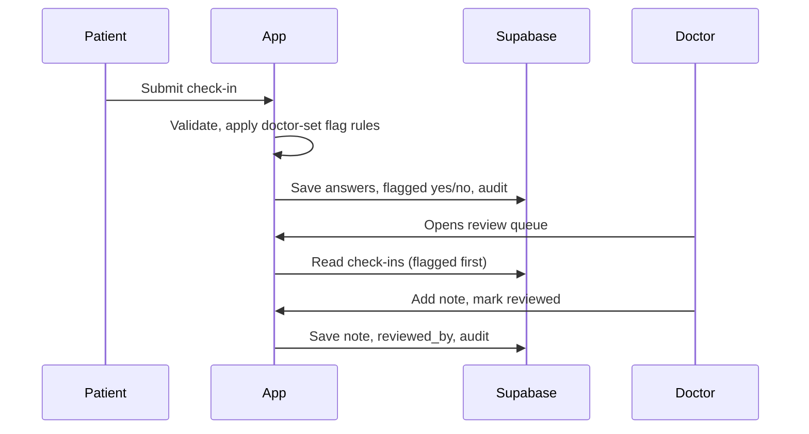

# Architecture Document
## Ayurvedic Clinic Patient Journey App

| Field | Value |
|---|---|
| Version | 0.1 (draft for BMAD pickup) |
| Date | 2026-10-20 |
| Owner | Ravi |
| Status | Draft architecture. Nothing is built. No project, database or deployment has been created |
| Companion documents | `brd.md` (requirements), `parked-decisions.md`, `BMAD_PICKUP.md` |

### Status tags (same as the BRD)
- `[DECIDED]` the owner decided it.
- `[PROPOSED]` Claude's suggestion, not decided by the owner, therefore **parked until confirmed**. The architect agent may use it as the working design and must flag it. Listed in `parked-decisions.md` Part B.
- `[PARKED]` open question with a `PK-nn` ID in `parked-decisions.md` Part A. Do not implement; do not guess.

Statements about product features of Supabase, Vercel and Next.js reflect general knowledge and the Supabase documentation pages read during research. Vendor plan limits, pricing and region lists were **not** checked and must be verified before commitment.

---

## 1. Purpose and drivers

Build one installable web application, used by clinic staff (coordinator, doctor, admin) and by patients, on one shared patient record that persists across visits (see BRD sections 1 and 6).

### Architecture drivers (ranked)
1. **Privacy and access control of health data** (patients see only their own data; staff by role; everything audited).
2. **Low friction for non-technical patients** (open from a link on a phone; no app store).
3. **Fast, short data entry for staff** (works equally well on phone and laptop, BR-12).
4. **Small team, small scale, low operating cost** (one clinic, hundreds to low thousands of patients).
5. **Ability to grow** to more clinics or native apps later without a rewrite.

## 2. Constraints from the owner `[DECIDED]`
- Web app first; installable to the home screen; native later only if needed.
- One single app with role-based views (not two apps).
- Frontend framework: Next.js.
- Hosting and deployment: Vercel.
- Database, authentication, file storage: Supabase.
- Development is cloud driven; the build uses Claude Code with the BMAD method.
- No building until the owner gives the go signal (go date PARKED, PK-20).

## 3. Solution overview

### 3.1 Logical view

```
 Patient phone / browser          Clinic phone / desktop browser
        (PWA, installed)                 (PWA or browser)
                  \                         /
                   \                       /
              ┌───────────────────────────────────┐
              │  Next.js app on Vercel            │
              │  • Patient area  • Clinic area    │
              │  • Server actions / route handlers│
              │  • Cron endpoints (secured)       │
              └──────────────┬────────────────────┘
                             │ user JWT (RLS applies)
              ┌──────────────▼────────────────────┐
              │ Supabase                          │
              │  Postgres (system of record, RLS) │
              │  Auth (staff MFA, patient links)  │
              │  Storage (private buckets)        │
              │  Edge Functions / scheduled jobs  │
              └───────┬───────────────┬───────────┘
                      │               │
              Email provider      (WhatsApp Business API: PARKED PK-08)
              (PK-22)             (Web push: PARKED PK-23)
```

### 3.2 Components

| Component | Responsibility | Status |
|---|---|---|
| Next.js app (one codebase) | UI for both roles; server-side rendering; server actions and route handlers; validation | DECIDED (Next.js, single app) |
| Vercel | Hosting, preview deployments, cron triggers | DECIDED (hosting) |
| Supabase Postgres | System of record; row-level security; audit triggers | DECIDED (Supabase) |
| Supabase Auth | Sign-in for staff and patients; MFA for staff | DECIDED (Supabase); methods PROPOSED |
| Supabase Storage | Private file buckets for documents | DECIDED (Supabase) |
| Scheduled jobs | Check-in prompts, reminders, supply and return nudges | PROPOSED; mechanism PARKED (PK-29) |
| Email provider | Invites, reminders, summaries | PARKED (PK-22) |
| WhatsApp | Optional sending; for now staff log conversations manually | PARKED (PK-08) |
| Web push | Optional later | PARKED (PK-23) |
| Error tracking and logs | Operations | PARKED tool choice (PK-25) |

## 4. Architecture decision records (ADR)

| ID | Decision | Rationale | Status |
|---|---|---|---|
| ADR-01 | Single deployable application (modular monolith). Clinic and patient areas live in one Next.js project, separated by route groups and role checks | Owner decision; one codebase; simple operations | DECIDED (single app); internal layout PROPOSED |
| ADR-02 | Next.js App Router with TypeScript | Next.js decided; App Router and TypeScript are the current default and give type safety end to end | Next.js DECIDED; rest PROPOSED |
| ADR-03 | Supabase Postgres is the only system of record | Owner decision | DECIDED |
| ADR-04 | Authorisation is enforced in the database with row-level security (RLS); the UI hides things but never is the only guard | Health data; defence in depth | PROPOSED |
| ADR-05 | The app talks to the database with the signed-in user's token so RLS applies. The service-role key exists only in server-side jobs and admin tools, never in the browser | Avoid bypassing RLS by accident | PROPOSED |
| ADR-06 | Staff sign in with email and password plus MFA (authenticator app). Patients sign in with a one-time link or code sent to their email, so they need no password | Non-technical patients; fewer support calls | Patient method DECIDED (PK-26); staff method PROPOSED |
| ADR-07 | Files live in private Supabase Storage buckets and are served through short-lived signed URLs; access rules mirror table rules | Passports and medical records | PROPOSED |
| ADR-08 | Audit: database triggers log changes; the server logs views of patient records. The audit log cannot be edited or deleted by any application role | Compliance and trust | PROPOSED |
| ADR-09 | Installable PWA: web manifest and a minimal service worker. Offline support limited to the app shell; no patient health data is cached offline | Home-screen requirement without storing health data on the device | Home screen DECIDED; offline scope PROPOSED |
| ADR-10 | Scheduled work (check-in prompts, reminders, nudges) is driven by one scheduler that calls idempotent, secured endpoints or functions | Reliability; no duplicate sends | PROPOSED; scheduler choice PARKED (PK-29) |
| ADR-11 | Notifications are stored in a table first (in-app inbox), then delivered by channel (in-app, email). Other channels plug in later | Channel-agnostic; WhatsApp undecided | PROPOSED |
| ADR-12 | All timestamps stored in UTC; each patient has a time zone; prompts and flight times display in the patient's local time | International patients | PROPOSED |
| ADR-13 | UI text lives in resource files from day one (English only first) | Languages undecided but likely | PROPOSED; languages PARKED (PK-07) |
| ADR-14 | Environments: local, preview (per pull request), staging, production. Database changes only through versioned migration files | Safe change; repeatable | PROPOSED |
| ADR-15 | No personal health data in application logs, error reports or analytics | Privacy | PROPOSED |
| ADR-20 | Clinic-agnostic, multi-tenant-ready design. A `clinics` table (name, slug, branding, locale, time zone, terminology and phase labels, feature flags, templates) holds everything specific to Ayurvedgram. Every clinic-owned table has `clinic_id`; profiles belong to a clinic; RLS helpers check clinic membership before role. Storage paths start with `clinic_id`. Only one clinic is live in v1; no clinic-switching UI, billing or self-service clinic signup | Owner decision: Ayurvedgram first, others later | DECIDED (agnostic); schema details PROPOSED |
| ADR-16 | Region of the Supabase project (and Vercel functions): India (Mumbai preferred) | Residency, closeness to clinic staff | DECIDED (India); availability and latency to verify in spike S-3, legal confirmation before real data |
| ADR-17 | Upload scanning for malware | Passports and records come from outside | PARKED (PK-27) |
| ADR-18 | Field-level protection of especially sensitive columns (for example passport number) beyond at-rest encryption and RLS | Defence in depth | PARKED (PK-28) |
| ADR-19 | Data retention and deletion jobs | Law and policy | PARKED (PK-18) |

## 5. Key quality attributes and how the design meets them

| Attribute | Approach |
|---|---|
| Security and privacy | RLS on every table; private storage; signed URLs; staff MFA; audit log; no PHI in logs; secrets only on server; security headers and a strict content security policy |
| Usability | Mobile-first components; large touch targets; short forms; clear labels and messages (section 8.5) |
| Performance | Server-rendered pages; indexes on patient, episode and date columns; paginate lists; avoid large file transfers through the app server (direct signed upload to storage) |
| Reliability | Idempotent jobs; retries with back-off for email; migrations tested on preview databases |
| Maintainability | One repo; typed shared validation; domain modules per phase; automated tests; generated database types |
| Evolvability | Multi-tenant ready from day one (ADR-20): `clinic_id` on every clinic-owned table, tenant isolation in RLS, clinic-specific content in configuration |
| Operability | Health checks; error tracking; dashboards for job failures; documented runbook |

## 6. Data architecture `[PROPOSED]`

Conceptual model for BMAD's architect to refine into migrations. Names are suggestions. Money is stored in minor units with a currency code. All tables carry `id` (uuid), `created_at`, `updated_at`; clinical and logistic tables also carry `created_by`. Records are soft-deleted (`deleted_at`) where law may require retention (PK-18).

### 6.1 Entity relationship (core)



### 6.2 Tables

| Table | Key columns | Notes |
|---|---|---|
| `clinics` | name, slug, branding (jsonb), default_locale, default_timezone, terminology (jsonb), settings (jsonb) | Ayurvedgram is the first row; see ADR-20 |
| `profiles` | id (= auth user id), clinic_id, role (`patient`, `staff`, `doctor`, `admin`), full_name, email, phone, locale, timezone, disabled_at | One row per login |
| `patients` | profile_id (nullable until invited), nationality (ISO country), date_of_birth, passport_number, emergency_contact (name, phone), photo_path, dietary_preferences, preferred_language, archived_at | Permanent record |
| `attendants` | patient_id, episode_id, name, relation, passport_number | Up to two per episode (business rule) |
| `episodes` | patient_id, phase (`enquiry`, `assessment`, `planning`, `arrival`, `care`, `continuity`), started_on, closed_on, primary_doctor_id, source | One per visit |
| `phase_events` | episode_id, from_phase, to_phase, changed_by, changed_at, note | History of phase moves |
| `enquiries` | episode_id (nullable for leads), lead_name, lead_contact, occurred_at, channel (`whatsapp`, `email`, `phone`, `other`), summary, treatment_interest, handled_by, source | Logged after the fact |
| `quotations` | episode_id, version, amount_minor, currency, inclusions, exclusions, valid_until, status (`sent`, `accepted`, `revised`, `lapsed`), sent_at, file_document_id | Versioned |
| `assessments` | episode_id, occurred_at, method (`in_person`, `whatsapp_call`, `phone`, `video`, `email`), doctor_id, findings, outcome, structured (jsonb, shape PARKED PK-10), visibility (`shared`, `private`) | |
| `plans` | episode_id, programme_name, duration_days, treatments (jsonb), diet_approach, approx_cost_minor, currency, status (`provisional`, `confirmed`, `refined_on_arrival`), quotation_id | One active per episode |
| `checklist_items` | episode_id, title, owner (`patient`, `clinic`), status, due_on | |
| `visas` | episode_id, traveller (`patient` or attendant id), visa_type (`ay1`, `ay2`, `other`), status, applied_on, expires_on, letter_document_id | |
| `travel_legs` | episode_id, kind (`inbound_flight`, `transfer`, `outbound_flight`, `outbound_transfer`), flight_number, airport, terminal, scheduled_at (UTC), entered_by_role, last_changed_by | Patient or clinic can write flight fields |
| `pickups` | travel_leg_id, driver_name, driver_phone, car, plate, meeting_point, pickup_at | Clinic-entered |
| `stays` | episode_id, place, room, check_in_at, check_out_at | |
| `daily_plans` | episode_id, plan_date, status (`draft`, `published`), published_at, stay_id | One per day per episode |
| `plan_items` | daily_plan_id, kind (`therapy`, `meal`, `medicine`, `review`, `other`), title, start_time, detail, therapist_name, sort_order | |
| `therapy_records` | plan_item_id, performed_at, therapist_name, duration_minutes, notes | |
| `doctor_notes` | episode_id, author_id, noted_at, text, visibility (`shared`, `private`) | |
| `medications` | episode_id, name, dose, schedule, start_on, duration_days, end_on, supply_end_on, prescribed_by, status | |
| `medication_intakes` | medication_id, intake_date, slot, taken_at, source (`patient`, `staff`) | Tick boxes in the day view |
| `checkin_templates` | kind (`care`, `follow_up`, `feedback`), version, questions (jsonb), active | Doctor-set; content PARKED (PK-14) |
| `checkins` | episode_id, template_id, scheduled_for, answered_at, answers (jsonb), medicines_taken (`yes`, `partly`, `no`), flagged, flag_reasons, reviewed_by, reviewed_at | |
| `flag_rules` | rule (jsonb), active, set_by | Content PARKED (PK-09) |
| `follow_up_schedules` | episode_id, template_id, start_on, cadence (jsonb), timezone, status | Creates future check-ins |
| `consultations` | episode_id, occurred_at, channel (`whatsapp_call`, `whatsapp_video`, `phone`, `video`, `message`, `other`), doctor_id, summary | Post-departure log |
| `documents` | patient_id, episode_id (nullable), kind (`passport`, `medical_record`, `letter`, `prescription`, `summary`, `other`), storage_path, mime_type, size_bytes, uploaded_by, visibility, deleted_at | Metadata; file is in Storage |
| `consent_versions` | text, language, effective_from | Wording PARKED (PK-04) |
| `consents` | patient_id, consent_version_id, scope (jsonb), given_at, given_via, withdrawn_at | Versioned, revocable |
| `messages` | episode_id, sender_id, body, attachment_document_id, read_at | Optional (FR-ACC-12) |
| `notifications` | recipient_id, channel (`in_app`, `email`), template, payload (jsonb), scheduled_for, sent_at, status, error | Outbox pattern |
| `audit_log` | at, actor_id, actor_role, action, table_name, record_id, patient_id, metadata (jsonb) | Append-only |

Indexes: `(patient_id)`, `(episode_id)`, `(episode_id, plan_date)`, `(scheduled_for) WHERE status = 'pending'` on notifications and check-ins, unique `(episode_id, plan_date)` on `daily_plans`, unique `(episode_id, version)` on quotations, unique lower(email) on profiles.

### 6.3 Authorisation matrix (RLS intent)

| Data | Patient | Staff (coordinator) | Doctor | Admin |
|---|---|---|---|---|
| Own profile and patient row | read; limited edit (contact, language) | read/write | read/write | read/write |
| Other patients | none | read/write | read/write | read/write |
| Enquiries, quotations | read own (shared) | read/write | read/write | read/write |
| Assessments | read own where `shared` | read | read/write | read |
| Doctor notes | read own where `shared` | read shared; private none | read/write | read |
| Medications | read own | read | read/write | read |
| Plans, daily plans, plan items | read own published | read/write | read/write | read/write |
| Travel legs: flight fields | read/write own | read/write | read | read/write |
| Pickups, stays | read own | read/write | read | read/write |
| Check-ins | read/write own answers | read | read/write (review) | read |
| Documents | read own where visible; upload own | read/write | read/write | read/write |
| Consents | read/give own | read | read | read/write |
| Audit log | none | none | none | read only |

Rules: a patient row is reachable only through `patients.profile_id = auth.uid()`; helper functions resolve role and patient ownership. Every policy also requires the row's `clinic_id` to match the caller's clinic (ADR-20); a cross-clinic access test is required for every table. Staff access to patients is not limited per doctor in v1 (parked if needed). Updates and deletes on `audit_log` are denied for all roles. Views expose patient-safe columns only.

### 6.4 Storage layout
- Private buckets: `patient-documents` (passports, medical records), `clinic-letters` (supporting letters, prescriptions, summaries), `profile-photos`.
- Path pattern: `{clinic_id}/{patient_id}/{episode_id or 'general'}/{document_id}.{ext}`.
- Uploads go directly to storage with a short-lived signed upload URL; the document row is created after the upload succeeds.
- Download via signed URLs that expire in minutes. Storage access rules mirror the documents table.
- Limits (types, size) proposed in section 8.4 and parked for confirmation.

## 7. Application architecture `[PROPOSED]`

### 7.1 Repository layout (suggested for BMAD)

```
/app
  /(public)            sign-in, invite acceptance, install help
  /(patient)           patient home, plan, documents, messages, check-in
  /(clinic)            patients list, onboarding, patient record tabs, review queue, admin
  /api/cron            secured scheduled endpoints
/components
  /ui                  buttons, inputs, chips, cards (design tokens)
  /patient /clinic     feature components
/lib
  /supabase            server and browser clients, typed queries
  /domain              one module per phase (enquiry, assessment, planning, arrival, care, continuity)
  /validation          shared Zod schemas used by forms and server actions
  /notifications       outbox, templates, senders
  /audit               view logging helpers
/messages              en.json (UI text), other languages later
/supabase
  /migrations          versioned SQL
  /seed.sql            dummy data only
/tests                 unit, integration, end to end
/docs                  brd.md, architecture.md, parked-decisions.md
```

### 7.2 Routing and roles
- Route groups separate patient and clinic areas. Middleware checks the session and the role, redirects patients away from clinic routes, and sends unauthenticated visitors to sign-in.
- The same URL scheme works for installed and browser use. Deep links from emails open the right screen after sign-in.

### 7.3 Server logic
- Reads happen in server components; writes use server actions or route handlers that validate input, call the database as the signed-in user, write an audit entry where needed, and return a typed result.
- Idempotency keys on actions that can be retried (check-in submit, publish plan).

### 7.4 UI and design system
- Tokens come from the owner-reviewed mockups: deep green accent `#2E5E4E`, green-tinted neutrals, phase chip colours (Enquiry grey, Assessment blue, Planning gold, Arrival terracotta, Care leaf green, Continuity teal), headings in Literata and body in Public Sans, light and dark themes. See `04_mockups.html`.
- Patient screens are phone width with a four-item bottom bar (Home, Plan, Documents, Messages). Clinic screens are responsive and fully functional on both phone and laptop for coordinator and doctor (BR-12): no feature may exist on one device class only, and layouts adapt (single column and large touch targets on phone; list-plus-detail and keyboard shortcuts on laptop).
- Status in form as well as colour (chips with text, not colour alone).

## 8. Quality design

### 8.1 Security architecture
- Authentication: sessions through Supabase Auth. Staff: password plus authenticator-app MFA. Patients: one-time link or code to email (PK-26). Session timeout shorter on staff devices; sign-out everywhere on role change.
- Authorisation: RLS everywhere (ADR-04); server actions re-check role; no client-side trust.
- Secrets: environment variables in Vercel and Supabase, never committed; the service-role key only in server jobs.
- Transport and headers: HTTPS only; strict content security policy; frame, referrer and permissions headers.
- Abuse controls: rate limits on sign-in, invite and upload endpoints; invite links single use and expiring.
- Files: type and size checks, signed URLs, malware scanning (PK-27).
- PHI handling: no personal health data in logs or error reports; passport numbers masked in lists; screenshots and exports watermarked or avoided (proposed).
- Backups: automated; restore tested (targets PK-24).
- Threat summary:

| Threat | Mitigation |
|---|---|
| Patient reads another patient's data | RLS plus tests that try cross-patient access |
| Stolen staff login | MFA, short sessions, audit alerts for unusual volume |
| Leaked file link | Short-lived signed URLs |
| Mass export by insider | Export limited to admin, logged |
| Injection and XSS | Typed queries, escaped output, content security policy |
| Spam or abuse of invite flow | Rate limits, single-use links |

### 8.2 Notifications and scheduling design
- Outbox: when something must be sent, a row goes into `notifications` (status `pending`, `scheduled_for`). A worker picks pending rows, sends through the channel, and marks `sent` or `failed` with retry.
- In-app inbox reads the same table. Email sends through the provider (PK-22). WhatsApp is not sent from the app (PK-08); staff may paste a message and log it as a consultation or enquiry.
- Follow-up scheduling: when a follow-up schedule is confirmed, the app generates future `checkins` rows and matching notification rows in the patient's time zone. A daily job creates the next window and sends due prompts. Jobs are idempotent (unique keys on episode, template and date).
- Scheduler mechanism (Vercel cron calling a secured endpoint versus a database scheduler calling an edge function) is PARKED (PK-29); both fit ADR-10. Verify cron frequency and plan limits first.

### 8.3 Deployment and environments
- Local development with a local database stack and seed data (dummy only).
- Pull request previews with a database branch (Supabase branching) for migration testing.
- Staging mirrors production settings; production holds real data only after the legal gate (BR-09).
- CI runs lint, type check, unit and integration tests, migration check, and end-to-end tests on preview.
- Releases are promotions of a tested build; database migrations run before the app; rollbacks use forward-fix migrations.
- Region of project and functions: PARKED (PK-05).

### 8.4 Validation rules (first set, all `[PROPOSED]`)

| Field | Rule | Message (plain, specific) |
|---|---|---|
| Full name | Required; 1 to 120 characters; letters, spaces, marks, hyphens, apostrophes, dots | "Enter the patient's full name." |
| Email | Required; valid format; unique | "Enter a valid email address, for example anna@example.com." / "A patient with this email already exists. Open their record instead." |
| Phone | Required; international format with country code (E.164) | "Enter the phone number with country code, for example +43 1 234 5678." |
| Nationality | Required; from the country list | "Select the patient's nationality." |
| Date of birth | Optional; not in the future; age 0 to 120 | "Date of birth cannot be in the future." |
| Passport number | Optional; 5 to 20 letters and digits | "Passport numbers use 5 to 20 letters and digits." |
| Emergency contact | If one part is entered, both name and phone are required | "Add a phone number for the emergency contact." |
| Flight number | Pattern for airline code plus number (for example `LX 148`) | "Enter the flight number as airline code and number, for example LX 148." |
| Arrival time | Valid date and time; must be provided with the airport | "Enter the arrival date and time." |
| Check-in answers | Medicines yes, partly or no; scores 1 to 5; free text up to 1,000 characters | "Choose an answer to continue." |
| Documents | PDF, JPG, PNG; up to a size limit; limit and HEIC support PARKED | "Upload a PDF, JPG or PNG file under 15 MB." (limit to confirm) |
| Quotation | Amount greater than zero; currency from list; validity date after sent date | "Enter an amount greater than zero." |

### 8.5 Error handling and messages (conventions)
- Every server action returns a typed result: success with data, or failure with a stable error code, a user-facing message and field-level errors.
- Error codes (proposed): `validation_failed`, `not_found`, `forbidden`, `conflict` (for example duplicate), `rate_limited`, `upload_rejected`, `schedule_conflict`, `unavailable`.
- Messages say what went wrong and how to fix it, in plain words, without blame or apology. Examples: "This file is larger than 15 MB. Choose a smaller file or compress it." and "We could not save the plan. Your changes are still on this screen. Try again."
- Forms keep the user's input on error; the first invalid field takes focus; errors are announced to assistive technology.
- Unexpected errors show a generic safe message with a reference ID; details go to error tracking without personal health data.
- Labels: sentence case, specific verbs ("Publish to patient", "Mark reviewed"), the same word for the same thing everywhere (for example always "check-in", never "survey" in one place).
- Empty states say what will appear and how to add the first item.

### 8.6 Observability and operations
- Health check endpoint; structured logs (no PHI); error tracking (tool PARKED, PK-25).
- Dashboards: failed notifications, overdue check-ins, job runs, slow queries.
- Runbook: how to rotate keys, restore a backup, handle a breach (72-hour reporting window per the guidance read), disable a user.
- Support: a documented way for patients to ask for export or erasure.

### 8.7 Testing strategy
- Unit tests for validation, flag rules, date and time zone logic.
- Database tests for RLS: for every table, a test that a patient cannot read or write another patient's rows and cannot read private notes.
- Integration tests for server actions and the outbox.
- End-to-end tests for the main journeys: onboard a patient, publish a day plan, patient completes a check-in, doctor reviews a flag, schedule follow-up.
- Accessibility checks on patient screens; manual test on real low-end phones.
- Seed data uses invented patients only.

### 8.8 Performance and scale
- Expected scale: one clinic, hundreds to low thousands of patients, tens of staff and daily-active patients. A single database instance is ample.
- Use indexes above, pagination for lists, and direct-to-storage uploads. Revisit if more clinics are added.

### 8.9 Accessibility and internationalisation
- WCAG 2.2 AA target for patient screens (NFR-02); visible focus, sufficient contrast in both themes, text resizing, no information by colour alone.
- Text from resource files; dates, times and numbers formatted per locale; time zone shown where it matters (flights, call times).

## 9. Key flows

### 9.1 Onboard and invite



### 9.2 Publish tomorrow's plan, patient views it



### 9.3 Check-in with flag and review



### 9.4 Follow-up after departure
Departure planner confirms a schedule, the system generates future check-ins in the patient's time zone, the daily job sends due prompts, answers return through flow 9.3, and consultations are logged by the doctor.

## 10. Build approach for BMAD `[PROPOSED]`

1. **Walking skeleton first:** one thin path end to end — sign in, onboard a patient, patient opens the invite, clinic enters flight and pickup, patient sees the arrival card — with RLS tests and audit from the start.
2. Then Care: daily plan, patient day view, check-in, review queue.
3. Then Enquiry, Assessment, Planning logs.
4. Then Continuity: follow-up schedule, check-in loop, consultation log.
5. Then notifications, compliance tooling, hardening.
Detailed epics are in BRD section 15.

## 11. Spikes and verification before commitment

| Spike | Question | Related |
|---|---|---|
| S-1 | Do installed web apps on iPhone receive web push reliably enough to depend on? | PK-23 |
| S-2 | Which scheduler fits: Vercel cron or a database scheduler? Check frequency and plan limits | PK-29 |
| S-3 | Which regions are available and what is the latency for India and Europe? | PK-05 |
| S-4 | Can Supabase Auth deliver one-time links reliably with the chosen email provider? Link expiry and single use | PK-22, PK-26 |
| S-5 | Direct signed uploads from a phone camera: file sizes, HEIC handling | PK-27 |
| S-6 | RLS performance and test harness for the full authorisation matrix | ADR-04 |
| S-7 | Is a Data Processing Agreement needed and available for each vendor? | PK-04 |

## 12. Parked architecture items

PK-05 region; PK-08 WhatsApp sending; PK-18 retention and deletion; PK-22 email provider; PK-23 web push; PK-24 availability and backup targets; PK-25 error tracking and monitoring tools; PK-26 patient sign-in method; PK-27 upload malware scanning; PK-28 field-level protection of sensitive columns; PK-29 scheduler mechanism. Full register: `parked-decisions.md`.

## 13. Risks specific to the architecture

| Risk | Mitigation |
|---|---|
| RLS mistakes expose data | Tests for every table; review of policies by a second agent or person; no service-role key in the browser |
| Email deliverability for invites | Verified sending domain; plain fallback code; staff can resend |
| Time zone errors in prompts | Store UTC; test with patients in several zones; show zone in messages |
| Vendor limits surprise later | Verify plans and limits in spikes S-2, S-3 |
| Health data cached on shared phones | No offline PHI; session timeouts; sign-out option |
| Scope creep from "nice to have" proposals | Only DECIDED items in the first sprint without owner confirmation |
